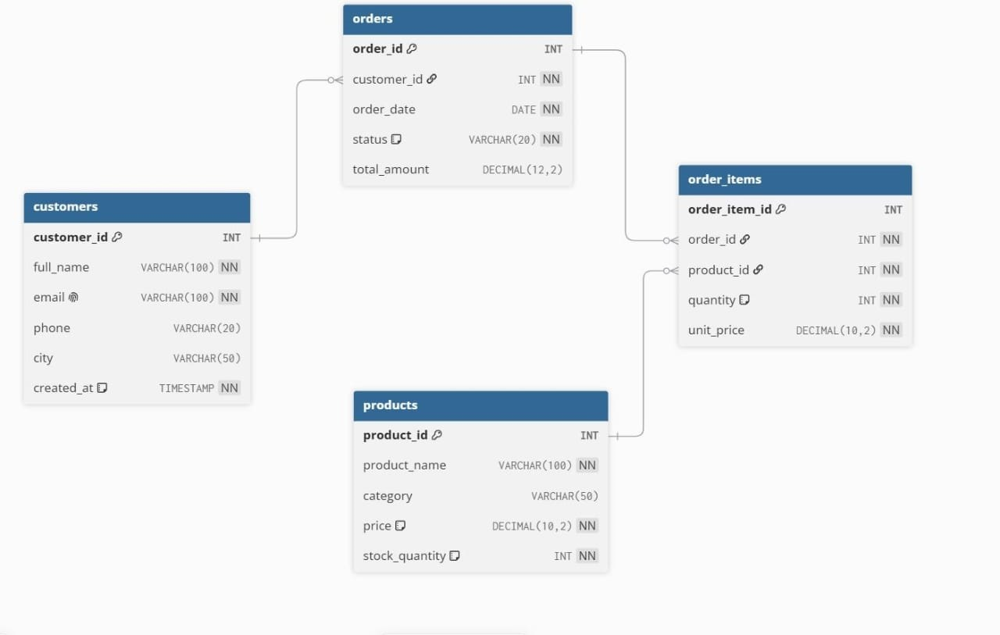

# Online-shopping-database-
# Online Shopping Database System

## 1. Project Overview

The Online Shopping Database System is a SQL table manipulation project that stores and manages the data of an online shopping platform.

The database is designed to manage customers, products, orders, and the items contained in each order.

The main objective of this project is to demonstrate how relational database tables can be created, connected, and manipulated using SQL.

**Database name:** `jesse_202512173_online_shopping`
**DBMS:** PostgreSQL

## 2. Project Objectives

* Identify the main entities of an online shopping system.
* Create tables with suitable columns, data types, and constraints.
* Define primary keys and foreign keys to connect related tables.
* Generate an Entity-Relationship Diagram (ERD) from the DBMS.
* Insert, retrieve, combine, and update data using SQL.
* Modify the structure of existing tables using ALTER TABLE.
* Understand how a database is structured before building an application on top of it.

## 3. Database Tables

The project contains four main tables:

1. **customers**: stores customer information (name, email, phone, city, creation date).
2. **products**: stores product information, price, category, and stock availability.
3. **orders**: represents a purchase made by a customer, with its date, status, and total amount.
4. **order_items**: represents a product entry in an order, with its quantity and unit price.

Each table has an automatically generated primary key. Data integrity is protected by constraints:

* **NOT NULL**: required values must be provided.
* **UNIQUE**: customer email addresses cannot be repeated.
* **CHECK**: price and quantity must be positive, stock cannot be negative, and order status must be Pending, Shipped, Delivered, or Cancelled.
* **DEFAULT**: the customer creation time is filled automatically.

## 4. Table Relationships

The database represents the following relationships:

* customers — orders: one customer can place many orders (foreign key `orders.customer_id`).
* orders — order_items: one order contains many order items (foreign key `order_items.order_id`).
* products — order_items: one product can appear in many order items (foreign key `order_items.product_id`).

The `order_items` table resolves the many-to-many relationship between orders and products. Product details are stored once and referenced by key, which avoids duplication and keeps the data consistent.

A **primary key** uniquely identifies each row in a table. A **foreign key** links a row in a child table to an existing row in a parent table, so a record can never refer to something that does not exist.

### Entity-Relationship Diagram

The ERD was generated from the actual database by the DBMS application.

## 5. Project Scope

### Included Features

* Database and table creation with constraints.
* Primary key and foreign key definitions.
* Initial data insertion (more than five records per table).
* Data retrieval with SELECT: basic, conditional, and sorted.
* Combining related tables with INNER JOIN, LEFT JOIN, and multi-table JOIN.
* Data modification with UPDATE: single record, multiple records, and conditional update.
* Structure modification with ALTER TABLE: renaming a column, changing a data type, and adding or removing a column.
* Additional records with INSERT: single, multiple, and related records.

### Excluded Features

* Payment processing and delivery management.
* Supplier and warehouse management.
* User authentication and security roles.
* Implementation of a complete website or mobile application.

## 6. Repository Contents

* `README.md`: project documentation.
* `assignment_iii.sql`: the complete SQL script, arranged in execution order.
* `erd.png`: the ERD generated from the DBMS.

## 7. Tools Used

* **PostgreSQL**: relational database management system.
* **pgAdmin 4**: for running SQL and generating the ERD.
* **GitHub**: for version control and project submission.

## 8. Author

**Name:** Jesse BINJA
**Student ID:** 202512173
**Project:** Online Shopping Database System
**Assignment:** Assignment III: SQL Table Manipulation
